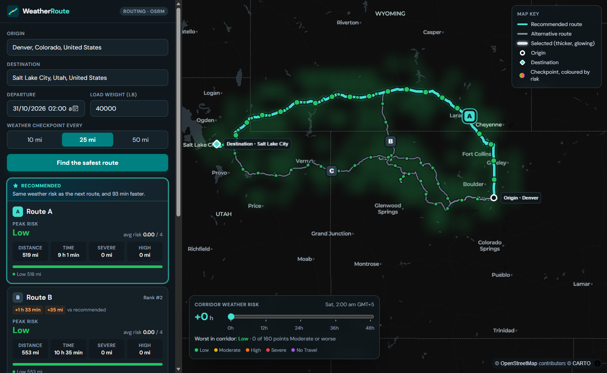
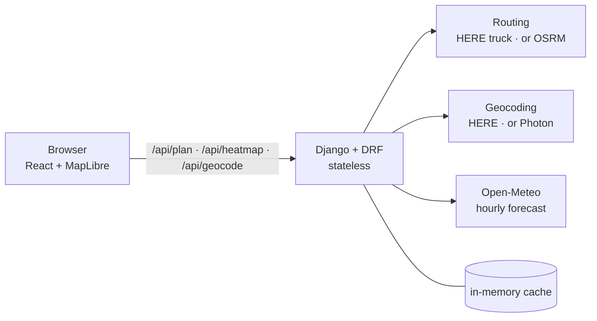

# WeatherRoute: Weather-Aware Truck Routing

A React + Django app that helps a truck driver pick the safest route. It compares
three routes by the forecast **at the hour the truck reaches each checkpoint**, its
**load weight** and **travel time**, then recommends one and explains why.

**Live app:** https://13.236.127.52.sslip.io (planner at [`/app`](https://13.236.127.52.sslip.io/app))
**Walkthrough (Loom):** _link to be added_



---

## Contents

- [What it does](#what-it-does)
- [How each requirement is met](#how-each-requirement-is-met)
- [Architecture](#architecture)
- [How the logic works](#how-the-logic-works)
- [Assumptions and decisions](#assumptions-and-decisions)
- [External APIs and why](#external-apis-and-why)
- [Performance](#performance)
- [Run it locally](#run-it-locally)
- [Tests and CI/CD](#tests-and-cicd)
- [Project layout](#project-layout)
- [Known limits](#known-limits)

## What it does

1. Enter **origin, destination, departure time and load weight**, and pick a weather
   checkpoint interval of **10, 25 or 50 miles**.
2. The backend gets **three routes**, places checkpoints along each, works out the
   truck's **ETA** at every checkpoint and reads the **forecast for that hour**.
3. Each checkpoint is graded **Low → Moderate → High → Severe → No Travel** using the
   brief's thresholds and load rules, and the routes are ranked.
4. The map shows all routes, checkpoints, risk levels and ETAs; the recommended route
   is turquoise and its card names the rule that decided it.
5. A **corridor heatmap** with a **0–48 hour slider** shows how the weather along the
   trip changes after departure.

## How each requirement is met

| Requirement (from the brief) | Where |
|---|---|
| User enters origin & destination, departure date/time, load weight | `frontend/src/components/TripForm.tsx`, validated in `backend/planner/serializers.py` |
| Generate **3 route options** with a routing API | `backend/planner/services/routing.py`, `planning._three_routes` |
| Sample weather every **10 / 25 / 50 miles** at the truck's **estimated arrival time** | `backend/planner/core/sampling.py`, `services/weather.py` (`Forecast.at`) |
| Weather risk from the **risk/load rules** | `backend/planner/core/risk.py` (40 boundary tests in `tests/test_risk.py`) |
| **Recommend** the best route, balancing risk and time | `backend/planner/core/ranking.py` |
| Show routes, checkpoints, risk levels, ETAs and summaries **on a map** | `frontend/src/components/MapView.tsx`, `RouteCards.tsx` |
| **Weather heatmap** along the corridor with a **0–48 h slider** | `core/corridor.py`, `/api/heatmap`, `MapView.tsx`, `ForecastSlider.tsx` |
| GitHub repo · hosted app · walkthrough | this repo · AWS EC2 (above) · Loom (above) |

## Architecture



- **Backend:** Django 5 + Django REST Framework, no database: every plan is computed
  per request. Pure logic lives in `planner/core/` (no I/O, fully unit-tested);
  provider clients live in `planner/services/`; `planner/planning.py` joins them.
- **Frontend:** React 19 + TypeScript + Vite + Tailwind, map by **MapLibre GL** on a
  CARTO dark basemap.
- **One container** in production: Django serves the API and, through WhiteNoise, the
  built React app, so there is one URL and no CORS.

### API

| Method | Path | Purpose |
|---|---|---|
| `GET` | `/api/health` | Liveness check |
| `GET` | `/api/geocode?q=` | Place suggestions for the form |
| `POST` | `/api/plan` | Three ranked routes with checkpoints, ETAs, weather and risk |
| `POST` | `/api/heatmap` | Risk at each corridor point for hours 0–48 after departure |

Provider failures return a readable **503** (with a *Try again* in the UI) rather
than a 500; a provider's rate limit fails fast instead of waiting a minute.

## How the logic works

**Routes.** The routing API's own alternatives are used first. When it offers fewer
than three distinct ones (the public OSRM server often returns one), more are forced
through **via points** to either side of the fastest route's midpoint. A candidate is
dropped if more than 85% of it overlaps a kept route or it takes over 1.6× the
fastest time, so the three options are real alternatives.

**Checkpoints and ETAs.** One checkpoint at the origin, one every *N* miles, one at
the destination. ETAs come from the routing engine's **per-segment travel times**,
not a distance ratio, so a slow city stretch takes longer than an interstate one.

**Weather.** Open-Meteo hourly `wind_speed_10m` (mph), `rain` + `showers` and
`snowfall`. Rain (mm) and snow (cm) are converted to in/hr in code, where the
conversion is visible and tested. Each checkpoint reads the forecast hour nearest
its ETA.

**Risk.** Each of wind, rain and snow gets a level from the table; the checkpoint
takes the **worst** of the three. Load rules then raise the wind level:

| Condition | Low | Moderate | High | Severe | No Travel |
|---|---|---|---|---|---|
| Wind | < 25 mph | 25–34 | 35–44 | 45–54 | ≥ 55 |
| Rain | < 0.10 in/hr | 0.10–0.25 | 0.25–0.50 | 0.50–1.00 | > 1.00 |
| Snow | < 0.5 in/hr | 0.5–1.0 | 1.0–2.0 | 2.0–3.0 | > 3.0 |

- ≥ 55 mph → No Travel for any load
- 45–54 mph with a load over 30,000 lb → No Travel
- 35–44 mph with a load over 40,000 lb → Severe

**Recommendation.** Routes are sorted by
`(No Travel miles, Severe miles, High miles, average risk, travel time)`, which is
the brief's order with No Travel miles in front (see assumptions). The card states
the rule that separated the winner from the runner-up, e.g. *"Fewer Severe miles
than the next route (10 vs 40)"*.

**Heatmap.** A grid of points every 20 miles along each route and 25 miles to either
side, snapped to 0.25° and capped at 250 points. One request returns every point's
risk for all **49 hours** (0–48).

## Assumptions and decisions

The brief leaves a few things open. Each choice below is made in one place in the
code and pinned by tests.

1. **Table edges.** Neighbouring columns share their edge values (rain 0.25 is in
   both Moderate and High). Bands are **half-open**: an edge value belongs to the
   **higher** band, so rain 0.25 in/hr is High.
2. **No Travel edges.** Rain and snow No Travel are written `> 1.00` and `> 3.0`, so
   exactly 1.00 in/hr rain or 3.0 in/hr snow stays **Severe**. Wind is written
   `≥ 55`, so 55 mph **is** No Travel.
3. **No Travel ranks first.** The brief's ranking starts at Severe miles and leaves
   No Travel out. A route through No Travel weather must never beat one that is only
   Severe, so No Travel miles are compared before everything else. If every route
   has some, the best is still shown with a warning to consider a later departure.
4. **Miles per checkpoint.** Each checkpoint stands for the road halfway back to the
   previous checkpoint and halfway on to the next, so every mile is counted exactly
   once when Severe/High miles are summed.
5. **Average risk** is distance-weighted (Low = 0 … No Travel = 4).
6. **Sustained wind**, not gusts, is graded, as the table gives one wind value.
7. **Rain includes showers**: Open-Meteo's `rain` leaves out convective showers.
8. **Load rules only raise** the wind level; they never lower it.
9. **Ties** are compared after rounding miles to 0.1 and average risk to three
   decimals, so float noise from sampling can't decide a tie the weather didn't.
10. **Slider hour 0 is the departure hour.** Departure must be within the next
    7 days, so the 48 hours after it stay inside the forecast.
11. **Units are US customary** (miles, mph, inches, pounds), as in the brief.

## External APIs and why

| Need | Used | Why this one |
|---|---|---|
| Routing | **HERE Routing v8, truck mode** when `HERE_API_KEY` is set; otherwise the public **OSRM** server | HERE plans for a truck's gross weight and returns alternatives. OSRM needs no key, so the app runs with zero setup. |
| Weather | **Open-Meteo** | Free, no key, hourly to 16 days, **many locations per request** (the heatmap needs that), rain/showers/snow per hour. |
| Place search | **HERE Geocoding**, else **Photon** | Photon is built for type-ahead; Nominatim's policy forbids autocomplete. |
| Map | **MapLibre GL** + CARTO tiles | Open source, no token, GPU-rendered layers, which is what keeps the slider smooth. |

**Note:** the live demo runs **without** a HERE key, so its routes come from OSRM's
**car** profile. The load weight is still applied in full by the risk rules; adding a
key in the server's `.env` switches routing to HERE's truck mode with no code change.

## Performance

- **Slider:** every corridor point carries all 49 hours as properties (`h0`…`h48`).
  Moving the slider only swaps the layer's paint expression, once per animation
  frame: **no request, no new GeoJSON, nothing for React to re-render.**
- **Map:** routes, checkpoints and the corridor are GPU layers, not DOM markers.
  The corridor is drawn as blurred circles coloured by each point's level, because a
  MapLibre `heatmap` layer sums overlapping points and would show calm weather as risk.
- **Backend:** forecasts are cached per 0.1° cell; requests to Open-Meteo go out in
  parallel batches; extra route alternatives are requested in parallel with a short
  timeout. A plan typically takes **3–5 s** on the server, most of it routing.
- **Delivery:** hashed assets are served as immutable; routes appear before the
  heatmap, which loads behind them.

## Run it locally

**With Docker (recommended):**

```bash
docker compose up
# app: http://localhost:5173   (Vite, hot reload; /api proxied to Django)
```

**Production image locally:**

```bash
docker compose --profile prod up --build app
# app: http://localhost:8000
```

**Without Docker:**

```bash
# backend (Python 3.12)
cd backend
python -m venv .venv && . .venv/bin/activate      # Windows: .venv\Scripts\activate
pip install -r requirements-dev.txt
DJANGO_DEBUG=true python manage.py runserver      # http://localhost:8000

# frontend (Node 22), in another terminal
cd frontend
npm ci && npm run dev                              # http://localhost:5173
```

Settings come from environment variables; see [`.env.example`](.env.example). Only
`DJANGO_SECRET_KEY` is required outside debug mode; `HERE_API_KEY` is optional.

## Tests and CI/CD

```bash
cd backend && pytest                 # 79 tests, 93% coverage of the planner package
cd frontend && npm run build         # tsc type-check + production build
```

| Test file | What it pins |
|---|---|
| `test_risk.py` (40) | every edge of the wind/rain/snow table and each load rule |
| `test_sampling.py` (9) | checkpoint spacing, segment-based ETAs, miles counted once |
| `test_ranking.py` (12) | each ranking rule alone, rule precedence, No Travel first, explanations |
| `test_api.py` (12) | full plan/heatmap requests with providers mocked; validation; 503s |
| `test_services.py` (6) | unit conversion, caching, HERE span parsing, corridor cap, geocoder |

**CI** (`.github/workflows/ci.yml`, every push and PR): ruff + pytest on Python 3.12;
Prettier, `tsc` and a production build; **gitleaks** over the full history; and a
Docker build.

**CD** (`.github/workflows/deploy.yml`): once CI passes on `main`, the image is built
on the runner, pushed to GitHub Container Registry tagged with the commit, and the
EC2 host pulls it and restarts. The job waits for Docker's health check, then checks
`/api/health` over public HTTPS.

**Hosting:** AWS EC2 `t3.micro` (Ubuntu) with **Caddy** in front for automatic
Let's Encrypt HTTPS, set up by [`deploy/setup-ec2.sh`](deploy/setup-ec2.sh).

## Project layout

```
backend/
  planner/core/        pure logic: risk.py, sampling.py, ranking.py, corridor.py, geo.py
  planner/services/    routing.py, weather.py, geocoding.py, http.py
  planner/planning.py  joins services and core into a plan and a corridor forecast
  planner/views.py     DRF endpoints; serializers.py validates input
  tests/               79 tests
frontend/src/
  pages/               Landing.tsx (/), Planner.tsx (/app)
  components/          MapView, RouteCards, ForecastSlider, TripForm, ...
deploy/                production compose file, Caddyfile, EC2 setup script
.github/workflows/     ci.yml, deploy.yml
```

## Known limits

- Without a HERE key, routing uses OSRM's **car** profile (see above).
- Open-Meteo's free tier is for non-commercial use, with per-minute limits; a busy
  minute returns a clear "try again" message.
- The forecast cache is in memory, per process, which suits one small server.
- A checkpoint reads the **nearest** forecast hour to its ETA rather than
  interpolating between hours.
